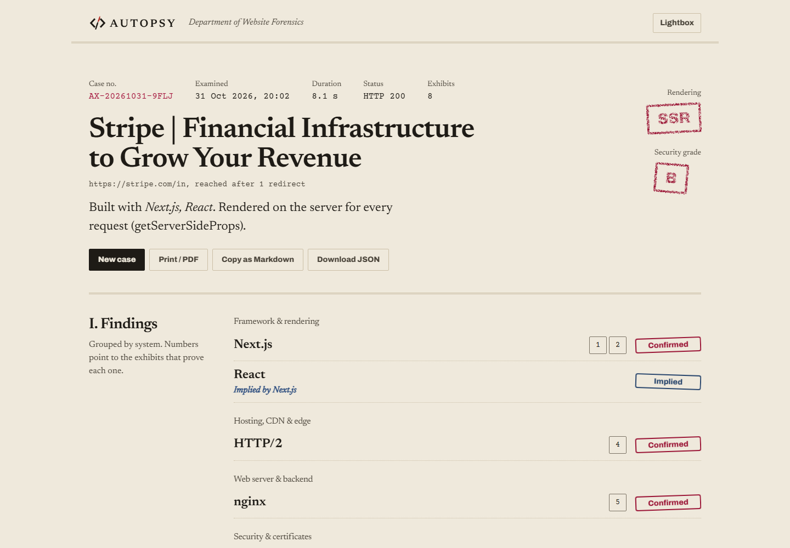
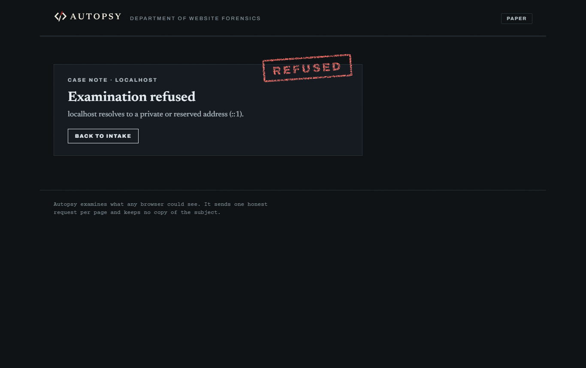
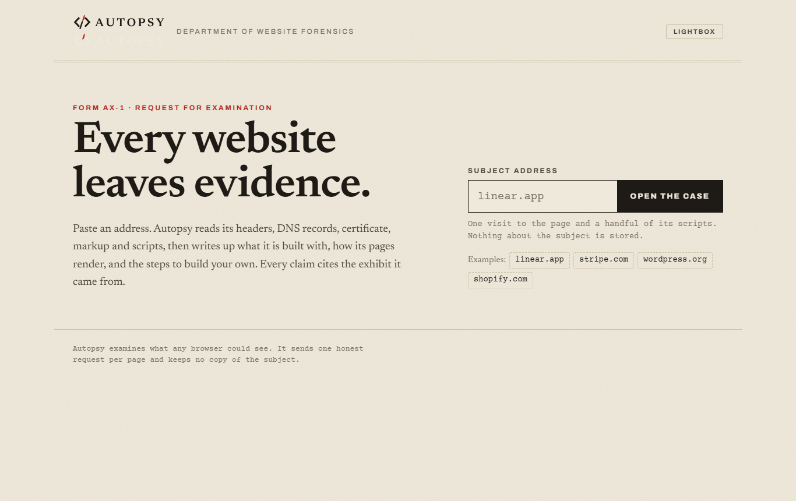

<p align="center"></p>

<p align="center"><b>Paste a URL. Get an evidence-backed teardown of how the site is built, and the steps to build your own.</b></p>

---

Most stack detectors give you a wall of logos. Autopsy writes a **case file**: every technology it names cites the exhibit that proves it (a header, a script URL, a DNS record, a line from a bundle). It also explains how the pages render and gives you a step-by-step plan to rebuild the same architecture.

<p align="center"></p>

## What an examination does

Stages stream to the browser live over Server-Sent Events. The log shows real progress, not a timer.

1. **DNS:** A/AAAA/CNAME/TXT on the host, NS and MX on the zone apex. The apex is found by walking up labels, which handles `www.bbc.co.uk` without a public-suffix list.
2. **Document:** one GET with manual redirects, decompression, and a 3 MB cap.
3. **Certificate:** issuer, expiry, SANs and the negotiated ALPN (which is how HTTP/2 shows up).
4. **Scripts:** up to six first-party bundles and three stylesheets, app bundles first.
5. **Signatures:** 170 hand-written rules over headers, cookies, meta tags, markup, script and stylesheet URLs, bundle contents, DNS and TLS. Evidence weights add up to **Confirmed**, **Probable** or **Trace**. A parent technology is added as **Implied** (Next.js implies React) rather than invented as evidence.
6. **Verdict:** SSR, SSG, ISR, CSR or hybrid, with the reasoning. Signals include `__NEXT_DATA__` flags, `x-nextjs-cache`, RSC payloads, empty mount nodes and the visible word count of the first response. Security headers and the certificate are graded A–F.
7. **Reconstruction protocol:** scaffold → styling → motion → data → accounts → payments → hosting → measurement → hardening. Each step carries real commands and cites the exhibits it follows from.

Export as print/PDF (a dedicated A4 layout), Markdown or JSON. Recent cases stay in your browser.

## Safety: the server fetches URLs strangers type

- Only `http`/`https`, ports 80/443/8080/8443, and no credentials in the URL.
- Every address a name resolves to is checked against private and reserved ranges using Node's `net.BlockList`. IPv4-mapped IPv6 and **NAT64** (`64:ff9b::/96`) addresses are judged by the IPv4 address they embed. If any answer is private, the request is refused.
- **The connection is pinned to the address that was checked** through a custom `lookup`, so DNS rebinding can't swap it after validation. Every redirect hop is checked again.
- Bodies are capped after decompression, so zip bombs stop at the limit. Cookie values never appear in exhibits.
- Rate limit and a 10-minute result cache per URL, plus an honest User-Agent.
- Autopsy sends a strict CSP, HSTS, `frame-ancestors 'none'`, nosniff, Referrer-Policy and Permissions-Policy on its own pages, so it passes its own exam.

The guard is covered by tests for loopback, metadata IPs, mapped and NAT64 addresses, a rebinding lookup, a redirect into `[::1]`, redirect loops and a gzip bomb.

<p align="center"></p>

## Run it

```bash
npm install          # TypeScript + Node types, for typechecking only
npm start            # http://localhost:3000
npm test             # guard, engine, verdicts, protocol
```

There are no runtime dependencies. Node 22.18+ runs the TypeScript directly. Set `PORT`, and `TRUST_PROXY=1` when running behind a reverse proxy.

```bash
docker build -t autopsy . && docker run -p 3000:3000 autopsy
```

### Deploy

The examiner needs `node:tls` peer certificates and its own DNS resolver, which the Workers runtime does not offer, so on Cloudflare the unchanged Node server runs as a **Container** behind a thin Worker (`worker/index.ts`, configured in `cloudflare.config.ts`). It needs Docker running locally and a Workers Paid plan.

```bash
npx cf auth login
npm run deploy
```

The Dockerfile also runs as is on any container host (Render, Fly.io, Railway, a VPS).

## Design: a forensic case file

Aged paper, a docket of case number, date, duration and status, Newsreader for the report, Courier Prime for typed evidence and Archivo for labels. Verdicts land as rubber stamps, set slightly off-axis and roughened with an SVG turbulence filter. Exhibits wear yellow evidence tags, and hovering an exhibit number lights every finding that cites it. The dark theme is a **lightbox**: the same file read as X-ray film.

<p align="center"></p>

## Limits

- Autopsy sees what a browser sees on the first load. It does not run JavaScript, so tools loaded later by a tag manager can be missed.
- Rules are hand-maintained in `server/signatures.ts`. Adding a technology is one entry.

MIT © 2026 Shailesh Upadhyay
